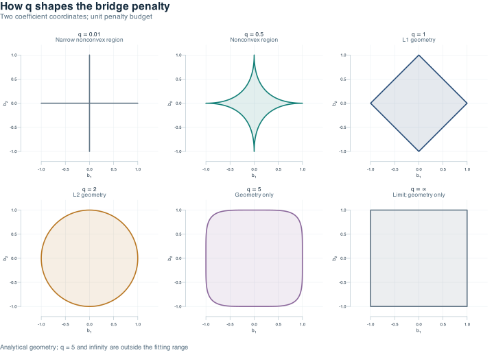
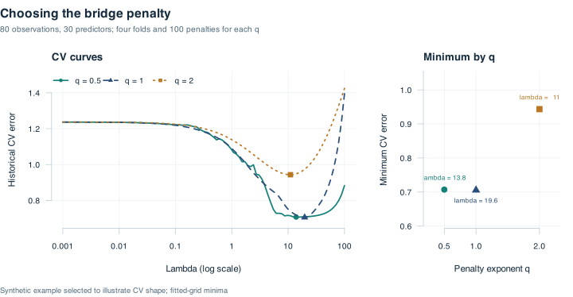
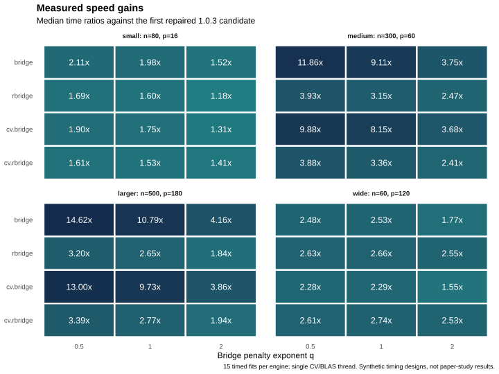

`rbridge` fits bridge-penalized linear models with optional linear coefficient
restrictions. The R interface provides coefficient paths, cross-validation,
predictions and coefficient extraction through compiled RcppArmadillo solvers.

The methodology is described in [Yuzbasi, Arashi and Akdeniz (2021),
*Penalized regression via the restricted bridge estimator*](https://doi.org/10.1007/s00500-021-05763-9).
The banner is decorative artwork.

Read the [online documentation](https://byuzbasi.github.io/rbridge/),
[getting started guide](https://byuzbasi.github.io/rbridge/articles/getting-started.html)
and [function reference](https://byuzbasi.github.io/rbridge/reference/index.html).

## Installation

Install the current [CRAN release](https://cran.r-project.org/package=rbridge):

```r
install.packages("rbridge")
```

Source installation requires R, a working C++ toolchain, and the Rcpp,
RcppArmadillo and Matrix packages. The 1.0.4 maintenance update gives every
C++ source file the same Armadillo configuration while preserving explicit
parallelism across cross-validation folds.

Install the GitHub version from R with the optional `remotes` package:

```r
remotes::install_github("byuzbasi/rbridge")
```

Run this command in the package source directory:

```sh
R CMD INSTALL .
```

Alternatively, install the built source archive from R:

```r
install.packages("rbridge_1.0.4.tar.gz", repos = NULL, type = "source")
```

## Penalty geometry and estimator

The bridge exponent controls the shape of a coefficient region. For two
coefficient coordinates and a unit penalty budget, the region contains points
whose absolute coordinates raised to `q` sum to at most one. This gives a
nonconvex region for `q < 1`, the L1 diamond for `q = 1` and the L2 disk for
`q = 2`. The following figure is generated from the mathematical boundary,
using the exponents in Figure 1 of the cited article.



The fitting functions support **0 < q <= 2**; the last two panels show geometry
only. Restricted bridge combines the bridge penalty with linear restrictions
on standardized slopes. At each local quadratic approximation (LQA) step,
it corrects the base update by an adjustment weighted by the LQA system matrix
to satisfy the supplied restrictions. Iteration uses the historical thresholding
and stopping rules. The
[getting started guide](vignettes/getting-started.Rmd)
defines the penalized target, LQA weights and restriction correction, with the
matrix assumptions and complete plotting code.

## A small working example

This is a demonstration with synthetic data, not a reproduction of the paper's
reported numerical results. It compares penalty exponents `q = 0.5, 1, 2`
using seed 2019, the same four folds and 100 logarithmically spaced penalties
from 0.001 to 100 for every exponent. The 80 observations have 30 correlated
predictors, three nonzero population slopes and Gaussian noise with standard
deviation 0.75. This example was selected to illustrate an interior CV minimum;
the pre-specified selection rule is documented in the getting started guide.

```r
library(rbridge)
set.seed(2019)
n <- 80
p <- 30
# Adjacent predictor correlation is 0.5; covariance decays with index distance.
Sigma <- outer(seq_len(p), seq_len(p), function(i, j) 0.5^abs(i - j))
X <- matrix(rnorm(n * p), n, p) %*% chol(Sigma)
colnames(X) <- paste0("x", seq_len(p))
beta <- c(1, 0.5, -0.2, rep(0, p - 3))
sigma <- 0.75
y <- as.numeric(1 + X %*% beta + sigma * rnorm(n))

# Restrict the fourth standardized predictor coefficient to zero.
R <- matrix(0, nrow = 1, ncol = p)
R[1, 4] <- 1
r <- matrix(0, nrow = 1)
lambda_cv <- exp(seq(log(100), log(0.001), length.out = 100))
q_values <- c(0.5, 1, 2)
cv_fits <- lapply(q_values, function(q) {
  cv.rbridge(X, y, q = q, R = R, r = r, lambda = lambda_cv,
             nfolds = 4, num_threads = 1)
})
names(cv_fits) <- paste("q =", q_values)
fit <- cv_fits[["q = 2"]]
# Display the intercept and first five slopes; coef() returns the full matrix.
coef(fit, s = "lambda.min")[1:6, , drop = FALSE]
predict(fit, newx = X[1:3, , drop = FALSE])
```



| q | Selected lambda | Minimum CV error |
| ---: | ---: | ---: |
| 0.5 | 13.8489 | 0.7071 |
| 1.0 | 19.6304 | 0.7055 |
| 2.0 | 10.9750 | 0.9434 |

The left panel marks each curve's `lambda.min`; the right panel compares the
minimum CV errors on a closer error scale. These are minima over the fitted
grid for this demonstration. They do not establish a preferred exponent for
other data. The [getting started guide](vignettes/getting-started.Rmd) contains
the comparison table and the complete plotting code. The existing `plot(fit)`
method remains available for an individual CV object.

## Functions

| Function | Purpose |
| --- | --- |
| `bridge()` | Unrestricted bridge coefficient path |
| `rbridge()` | Bridge coefficient path with linear restrictions |
| `cv.bridge()` | Cross-validation for an unrestricted model |
| `cv.rbridge()` | Cross-validation for a restricted model |
| `coef()` / `predict()` | Extract coefficients or predict from fitted models |
| `plot()` | Display cross-validation errors and selected penalties |
| `rbridge_info()` | Inspect compiled OpenMP support and package version |

The supported penalty exponent is positive and at most two. The exponent
controls the bridge penalty; one and two give the L1 and L2 penalty forms.
The solver uses local quadratic approximation and the historical elimination
and convergence thresholds.

## Coefficient scales and selectors

**Restrictions apply to standardized predictor coefficients.** Predictors are
centered and divided by their root-mean-square centered deviations before fitting.
Returned coefficients include a reconstructed intercept and are on the original
predictor scale. Consequently, applying the same restriction matrix directly to
returned slopes generally tests a different restriction. The intercept is not
part of the restriction matrix.

For CV objects, prediction defaults to `lambda.min`; coefficient extraction
defaults to `lambda.1se`. For path objects, omitting `s` returns the entire path.
A numeric `s` selects exact values already present in the fitted lambda grid;
there is no interpolation. A path object's `s = "lambda.min"` selects the
smallest fitted penalty, while `lambda.1se` requires a CV object. Nonzero indices
are reported over the whole fitted path, preserving the historical behavior.

The historical contiguous fold allocation and CV-error aggregation are retained.
Use `num_threads = 1` for a sequential demonstration; multithreading depends on
the build's OpenMP support. Inspect it with `rbridge_info()`. Supported builds
use at most one worker per fold; unsupported builds run sequentially.
Set BLAS threads to one before starting R when requesting parallel CV.

The maintenance update caches fixed and active-set cross-products, reuses CV
data slices and solves the restricted coefficient and constraint systems together.
These are implementation changes to the historical estimator. Speed ratios
depend on design size, penalty, toolchain and hardware; no universal speedup is
claimed. Singular or numerically unresolved systems fail explicitly without
substituting an approximate fit.

## Measured performance

The completed benchmark compares the optimized engine with the first repaired
1.0.3 candidate on four synthetic designs, three penalty exponents and all four
fitting interfaces. Each engine uses two warmups and 15 timed fits per case.
The speed ratio divides the baseline median time by the optimized median time.

| Method | Median speed ratio across 12 cases | Measured range |
| --- | ---: | ---: |
| `bridge()` | 3.14x | 1.52-14.62x |
| `rbridge()` | 2.59x | 1.18-3.93x |
| `cv.bridge()` | 2.99x | 1.31-13.00x |
| `cv.rbridge()` | 2.57x | 1.41-3.88x |



All 96 timing shards and 48 numerical comparisons pass validation. Selected
penalties, variable support and variable counts match exactly; the maximum
relative coefficient/CV difference is 5.51e-14. These timings use one CV worker
and one BLAS thread on an Apple M3 Pro with R 4.6.0. The fixed engine order and
single machine limit generalization. This measures serial optimization against
the repaired candidate, rather than a direct speed comparison with CRAN 1.0.2
or a reproduction of the article's numerical study.

See the [benchmark report](inst/doc/benchmarks/REPORT.txt),
[case comparisons](inst/doc/benchmarks/comparison.tsv),
[individual timings](inst/doc/benchmarks/timings.tsv) and
[recorded protocol and environment](inst/doc/benchmarks/provenance.json).

## Guides and citation

* [Reproducibility and validation scope](https://byuzbasi.github.io/rbridge/articles/reproducibility.html)
* [Getting started guide](https://byuzbasi.github.io/rbridge/articles/getting-started.html)
* [Vignette source](vignettes/getting-started.Rmd)
* [Version notes](NEWS.md)
* Contribution guidelines: `CONTRIBUTING.md` in the source repository
* [Source repository](https://github.com/byuzbasi/rbridge)
* [Report a reproducible issue](https://github.com/byuzbasi/rbridge/issues)

```r
citation("rbridge")
```

Yuzbasi, B., Arashi, M. and Akdeniz, F. (2021). Penalized regression via the
restricted bridge estimator. *Soft Computing*, **25**, 8401-8416.
[doi:10.1007/s00500-021-05763-9](https://doi.org/10.1007/s00500-021-05763-9).

The package is licensed under GPL-3. Utility-function attribution inherited from
the original source is retained.

From a source-repository checkout with `rbridge` installed, build the site
with the optional `pkgdown` tool and the repository's documentation script:

```r
system2("Rscript", c("--vanilla", "tools/build-site.R", ".", "docs"))
```

The site includes the working guide, curated function reference and validation
scope. The script also renders reference equations as native MathML using
Pandoc, so they can be read offline. Building it does not publish a website.
